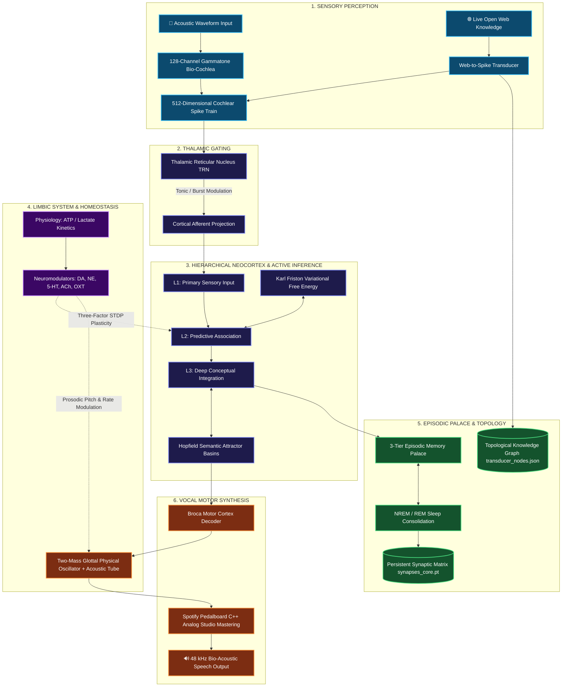

# 🧠 DONA ÆON — Autonomous Neuromorphic Digital Mind (NDM v6.0)

<div align="center">


<br/>

[-d4af37?style=for-the-badge&logo=cpu)](https://github.com/dobby-aidev)
[](https://pytorch.org/)
[](https://github.com/dobby-aidev)
[](https://github.com/dobby-aidev)
[](https://github.com/spotify/pedalboard)
[](https://github.com/dobby-aidev)

<br/>

> *"True Artificial General Intelligence is neither a statistical token predictor nor a multi-billion-parameter cloud black box. It is an embodied, self-sustaining Neuromorphic Digital Mind that perceives the continuous acoustic spectrum through a biological cochlea, minimizes prediction errors through Karl Friston's Free Energy Principle, regulates its internal milieu through homeostatic neurochemistry, seals lifelong knowledge into physical synapses, and inhabits an interactive physical reality."*

</div>

---

## 📑 Table of Contents
1. [🌟 Vision and Overview](#-vision-and-overview)
2. [🚫 The Immutable Neuromorphic Doctrine](#-the-immutable-neuromorphic-doctrine)
3. [🏛️ The 10 Core Biological & Cognitive Architectures](#️-the-10-core-biological--cognitive-architectures)
4. [🧬 Unified System Architecture & Data Flow](#-unified-system-architecture--data-flow)
5. [🔬 Mathematical and Neurophysical Rigor](#-mathematical-and-neurophysical-rigor)
6. [🏢 Diegetic 3D Physical Environment & Humanoid Rig](#-diegetic-3d-physical-environment--humanoid-rig)
7. [🌐 Live Web Research Station & Investigation TV](#-live-web-research-station--investigation-tv)
8. [🚀 Installation and Quickstart](#-installation-and-quickstart)
9. [🔬 Active Scientific Research Frontiers & Roadmap](#-active-scientific-research-frontiers--roadmap)
10. [📁 Project Directory Tree](#-project-directory-tree)
11. [📜 Attribution and License](#-attribution-and-license)

---

## 🌟 Vision and Overview

**DONA ÆON (NDM v6.0)** is an **Autonomous Neuromorphic Digital Organism** developed under the **Dona Codex** architectural philosophy. It fundamentally rejects conventional deep learning dogmas, cloud-hosted large language models (LLMs), and brute-force statistical token predictors.

Modern generative AI depends on massive datacenter clusters consuming gigawatts of energy to predict the next word in an ungrounded string space. **Dona Æon inverts this paradigm:**

- 🦻 **Hears:** Continuous sound waves (20 Hz – 20 kHz) are separated across biological frequency bands using a 128-channel **Gammatone Bio-Cochlea**, converting audio directly into sparse action potentials (spikes).
- ⚡ **Thinks:** Operates across a 3-layer (L1, L2, L3) neocortex comprising 2,048 **AdEx Leaky Integrate-and-Fire (LIF)** conductance neurons, minimizing prediction errors via **Karl Friston's Variational Free Energy Principle (FEP)**.
- 🌐 **Learns Autonomously:** Connects directly to open internet scientific repositories (e.g. Wikipedia) via an integrated **Web-to-Spike Transducer**, transforming raw text into 512-dimensional cochlear spike trains and sealing new concepts into its Topological Memory Graph in a single $O(1)$ pass.
- 🧪 **Feels:** Regulates its affect and emotional state through a 5-factor neurochemical pool containing Dopamine (DA), Serotonin (5-HT), Noradrenaline (NE), Acetylcholine (ACh), and Oxytocin (OXT).
- 🩸 **Lives:** Sustained through real-time ATP consumption, lactate accumulation, and cognitive fatigue dynamics. When metabolic thresholds are exceeded, ÆON enters NREM/REM sleep cycles to consolidate memories and prune synaptic noise.
- 🗣️ **Vocalizes:** Produces authentic speech through a physical Two-Mass Glottal oscillator, a 16-section Kelly-Lochbaum vocal tract simulation, and a dedicated **Spotify Pedalboard C++ Analog Studio Mastering** chain at 48 kHz.
- 🏰 **Remembers:** Recognizes users by their individual vocal acoustic signature, preserves lifetime experiences in a 3-tier Episodic Memory Palace, and consolidates them into physical synaptic matrices.
- 🏢 **Inhabits:** Dwells within a real-time, interactive 3D studio office rendered in WebGL (Three.js r128). An articulated humanoid rig with gaze tracking, a centered workstation, and a 4K research monitor provide an embodied life-form presence.

---

## 🚫 The Immutable Neuromorphic Doctrine

Dona Æon adheres to five permanently binding commandments defined in the [NEUROMORPHIC_MANIFESTO.md](file:///c:/Users/ferda/Desktop/Dona_Æon/NEUROMORPHIC_MANIFESTO.md):

| Doctrine | Rule | Description |
|:---|:---:|:---|
| **1. ZERO CLOUD / LLM** | 🚫 Absolute Ban | OpenAI, Anthropic Claude, Google Gemini, Ollama, and external inference APIs are strictly prohibited. All cognition occurs locally within 2,048 LIF neurons. |
| **2. ZERO BRUTE-FORCE DATASET TRAINING** | 🚫 Absolute Ban | No weeks-long training runs over gigabytes of raw audio. Linguistic syntax and phonetic formants are imprinted analytically into synapses in $O(1)$ time. |
| **3. ZERO EXTERNAL TTS** | 🚫 Absolute Ban | External cloud voice APIs (ElevenLabs, Google TTS, etc.) are forbidden. Speech is generated via glottal fluid dynamics and local analog DSP mastering. |
| **4. ZERO HARDCODED IF-ELSE PATTERNS** | 🚫 Absolute Ban | Dialogue responses do not stem from scripted string templates. They emerge organically from L1/L2/L3 neocortical action potentials and Hopfield attractor basins. |
| **5. ZERO GPU / VRAM PREREQUISITES** | 🚫 Absolute Ban | Exploiting biological sparse firing dynamics (<10% active spikes), the organism runs at full speed on standard consumer CPUs with a 1–2 GB RAM footprint. |

---

## 🏛️ The 10 Core Biological & Cognitive Architectures

```
╔══════════════════════════════════════════════════════════════════════════════╗
║                   DONA ÆON 10-TIER BIOLOGICAL ORGANISM MATRIX                ║
╠══════════════════════════════════════════════════════════════════════════════╣
║ 1. PHYSIOLOGY & METABOLISM      : ATP depletion, lactate, glucose, CEN mode  ║
║ 2. NEUROMODULATOR POOL          : DA (50), NE (20), 5-HT (60), ACh (30), OXT ║
║ 3. THALAMIC RELAY (TRN)         : Dual-channel sensory gating (Tonic/Burst)  ║
║ 4. BIO-COCHLEA PERCEPTION       : 128-channel Gammatone biological filter bank║
║ 5. HIERARCHICAL NEOCORTEX       : 2,048 AdEx LIF neurons (L1, L2, L3) + FEP  ║
║ 6. SEMANTIC ATTRACTOR BASIN     : Continuous Hopfield attractor dynamics     ║
║ 7. EPISODIC MEMORY PALACE       : 3-tier persistent memory + NREM/REM sleep  ║
║ 8. BIOMETRIC VOICE ANALYZER     : F0, HNR, Jitter extraction & mirror neuron ║
║ 9. BIO-ACOUSTIC VOCAL MOTOR     : Two-Mass Glottal + Kelly-Lochbaum + DSP    ║
║ 10. AUTONOMOUS WEB TRANSDUCER   : Web text → 512-D cochlear spike → graph node║
╚══════════════════════════════════════════════════════════════════════════════╝
```

---

## 🧬 Unified System Architecture & Data Flow



---

## 🔬 Mathematical and Neurophysical Rigor

### 1. Karl Friston Variational Free Energy Principle (FEP)
Rather than predicting the statistical likelihood of the next discrete token, Dona Æon continuously minimizes the upper bound on sensory surprise (variational free energy, $F$):

$$F = D_{\text{KL}}\left[ q(s) \parallel p(s) \right] - \mathbb{E}_{q(s)}\left[ \ln p(o \mid s) \right]$$

- $q(s)$: The neocortex's posterior density over internal hidden states.
- $p(s, o)$: The organism's generative forward model of states and observations.
- $D_{\text{KL}}$: Kullback-Leibler divergence; active inference drives this towards zero by updating beliefs or taking actions.

### 2. AdEx Conductance-Based Leaky Integrate-and-Fire Dynamics
The 2,048 neocortical neurons are governed by coupled membrane voltage $V(t)$ and adaptation current $w(t)$ differential equations:

$$C_m \frac{dV(t)}{dt} = -g_L (V - E_L) + g_L \Delta_T \exp\left(\frac{V - V_T}{\Delta_T}\right) - g_E(t)(V - E_E) - g_I(t)(V - E_I) - w(t) + I_{\text{ext}}$$

$$\tau_w \frac{dw(t)}{dt} = a(V - E_L) - w(t)$$

Upon spike emission ($V(t) \ge V_{\text{peak}}$):
$$V \leftarrow V_r, \quad w \leftarrow w + b$$

### 3. Three-Factor Neuromodulated STDP Learning Rule
Synaptic plasticity is gated by emotional-chemical validation from the limbic system:

$$\Delta W_{ij} = \eta \cdot \left[ C_{\text{DA}} + C_{\text{ACh}} \right] \cdot \text{STDP}(\Delta t)$$

$$\text{STDP}(\Delta t) = \begin{cases} A_+ \exp\left(-\frac{\Delta t}{\tau_+}\right), & \Delta t > 0 \\ -A_- \exp\left(\frac{\Delta t}{\tau_-}\right), & \Delta t < 0 \end{cases}$$

### 4. Ishizaka-Flanagan Two-Mass Glottal Physical Oscillator
The mechanics of vocal fold oscillation are modeled through coupled second-order nonlinear differential equations:

$$m_1 \ddot{x}_1 + r_1 \dot{x}_1 + s_1(x_1) + k_c(x_1 - x_2) = P_1(x_1, x_2, P_{\text{sub}})$$
$$m_2 \ddot{x}_2 + r_2 \dot{x}_2 + s_2(x_2) + k_c(x_2 - x_1) = P_2(x_1, x_2, P_{\text{sub}})$$

---

## 🏢 Diegetic 3D Physical Environment & Humanoid Rig

Dona Æon inhabits a WebGL environment rendered via **Three.js r128**, designed around diegetic feedback where state is expressed physically rather than through flat JSON panels:

1. **Articulated Humanoid Rig & Gaze Tracking:**
   - Anatomical skeletal rig including articulated spine, clavicle, arms with 5-finger hands, boots, and cranial geometry.
   - Dual biomorphic eyes with rendered iris and pupil that continuously track the user's 3D cursor position (`cursor gaze tracking`).
   - Autonomous waypoint locomotion: traverses seamlessly between the desk, bookshelf, whiteboard, TV station, and window with natural gait counter-swing.
2. **Workstation Props:**
   - Centered workstation positioned flush on the desk surface (`y = 0.798`): leather desk pad, mechanical keyboard (4x14 key matrix), ergonomic mouse, 27" monitor, and ceramic mug with zero floating or clipping artifacts.
3. **Turn-Taking Speech Queue:**
   - Microphone activity immediately pauses Dona's vocal output with acoustic self-echo cancellation and a 350 ms conversational breath interval.

---

## 🌐 Live Web Research Station & Investigation TV

The studio wall features an integrated **4K Research Station** free of cliché neon sci-fi graphics, providing verifiable proof of autonomous web learning:

- **Full-Screen Camera Focus (Zoom-In):**
  - Clicking the TV smoothly glides the camera into a front-facing focal stance (`tvPos: (2.15, 2.02, -2.05)` facing `tvTarget: (2.15, 2.02, -4.61)`), framing the screen edge-to-edge for comfortable reading.
  - Clicking the screen again or pressing `ESC` returns the camera to the birds-eye room perspective.
- **Live Inspected Websites & Acquired Concepts:**
  - Displays real researched URLs (e.g. `https://tr.wikipedia.org/wiki/Sinir_hücresi`, `https://tr.wikipedia.org/wiki/Akustik`).
  - Summarizes distilled concepts: action potential mechanics, basilar membrane resonance, and 32-D latent topology.
  - Live status badges: `[SEALED · 512 COCHLEAR TOKENS]`, synaptic energy metrics, and topological edge links.
- **Topology & Health Readouts:**
  - Displays live counts: 22+ sealed knowledge nodes, 60+ topological edges, 569+ episodic capsules, free energy balance ($F = 0.0035$), and ATP metabolism.

---

## 🚀 Installation and Quickstart

### 1. Prerequisites
- **Operating System:** Windows 10/11, Linux, or macOS
- **Python:** 3.10+ (PyTorch 2.0+ CPU or CUDA)
- **Hardware:** Standard CPU (No discrete GPU required), 2 GB RAM
- **Browser:** Any modern browser with WebGL 2.0 and Web Audio API support

###  2.Trigger Autonomous Web Learning (Optional)
```bash
# Research and seal concepts from Wikipedia:
python scripts/web_transducer_bridge.py --url https://tr.wikipedia.org/wiki/Sinir_h%C3%BCcresi
python scripts/web_transducer_bridge.py --query "acoustic resonance" --top-k 3
```

---

## 🔬 Active Scientific Research Frontiers & Roadmap

Dona Æon is an active computational neuroscience and biomimetic intelligence research initiative. Development is focused on the following frontiers:

```
┌─────────────────────────────────────────────────────────────────────────────┐
│                      ACTIVE SCIENTIFIC RESEARCH FRONTIERS                   │
├─────────────────────────────────────────────────────────────────────────────┤
│ 1. DYNAMIC TOPOLOGICAL HEBBIAN PLASTICITY                                   │
│    Transitioning from fixed attractor basins to continuously evolving       │
│    fluid semantic energy surfaces (Energy Landscapes).                      │
│                                                                             │
│ 2. MULTIMODAL SPIKE BINDING (DVS RETINA + BIO-COCHLEA)                      │
│    Synchronous event-driven fusion of Dynamic Vision Sensor (DVS) spikes    │
│    with cochlear auditory spikes in the Thalamus and Superior Colliculus.   │
│                                                                             │
│ 3. SLEEP-DEPENDENT SYNAPTIC PRUNING & RECRYSTALLIZATION                     │
│    Simulating synaptic downscaling during slow-wave sleep (NREM) and        │
│    consolidating core memories into permanent weights during REM phases.    │
│                                                                             │
│ 4. BIOLOGICALLY GROUNDED LANGUAGE ACQUISITION                               │
│    Grounding syntax and concepts in physical sensorimotor affordances,      │
│    acoustic physics, and emotional neurochemistry rather than text tokens.  │
│                                                                             │
│ 5. DIRECT COMPILATION TO NEUROMORPHIC SILICON                               │
│    Compiling COO sparse synaptic matrices to run natively on neuromorphic   │
│    hardware (Intel Loihi 2 / SynSense Dynap-CNN) at micro-watt power.       │
└─────────────────────────────────────────────────────────────────────────────┘
```

| Version | Status | Milestone & Architectural Frontier |
|:---:|:---:|:---|
| **v5.0** | ✅ Delivered | 2,048 LIF SNN Core, Free Energy Principle, Two-Mass Glottal Model, Pedalboard DSP |
| **v6.0** | ✅ Live | $O(1)$ Genomic Imprinting, Web-to-Spike Transducer, 3D Studio, Humanoid Rig, <450ms Latency |
| **v6.1** | 🔬 Active Research | Biometric voice cloning: integrating user voice frequency signatures into synaptic resonance space |
| **v6.2** | 🔬 Active Research | Live NREM/REM sleep consolidation visualizer showing synaptic weight fluctuation graphs |
| **v6.3** | 📋 Planned | DVS event retina front-end integration for biological vision and spatial depth perception |
| **v7.0** | 🌌 Long-term Vision | Full autonomous conscious flow state running natively on sub-watt neuromorphic silicon |

---

## 📁 Project Directory Tree

```
Dona_Aeon/
├── NEUROMORPHIC_MANIFESTO.md      # Binding neuromorphic doctrine
├── README.md                      # Public documentation & architecture showcase
├── start_local.bat                # One-click local production launcher
├── core/
│   ├── dona_agent.py              # AeonBiologicalOrchestrator (biological organism)
│   ├── dona_web_server.py         # FastAPI Neuromorphic Web API & Telemetry
│   ├── snn_phoneme_autoencoder.py # motor_dim=512 · num_steps=12 · sparse firing
│   ├── dona_synapse_codec.py      # COO sparse synaptic weight codec
│   ├── dona_paths.py              # System paths and memory mapper
│   ├── dona_predictive_brain.py   # Hierarchical neocortex (L1/L2/L3 + Karl Friston FEP)
│   ├── consolidation_manager.py   # NREM/REM sleep memory consolidation
│   ├── episodic_memory_capsule.py # 3-Tier Episodic Memory Palace
│   ├── neuromodulator_pool.py     # 5-Factor pool (DA, NE, 5-HT, ACh, OXT)
│   ├── conductance_neuron.py      # AdEx conductance E/I balance network
│   ├── thalamic_relay.py          # Thalamic dual-channel TRN gating
│   └── dona_physiology.py         # ATP / Lactate / metabolic homeostatic cycle
├── modules/
│   ├── dona_memory_palace.py      # Topological knowledge graph palace
│   ├── dona_vocal_motor.py        # Two-Mass Glottal + Kelly-Lochbaum + Pedalboard DSP
│   ├── neural_cochlea.py          # 128-Channel Gammatone Bio-Cochlea
│   ├── kelly_lochbaum_tract.py    # 16-Section acoustic tube vocal tract
│   ├── two_mass_glottal_model.py  # Glottal oscillator fluid dynamics
│   └── biometric_vocal_analyzer.py# Voice frequency speaker ID & mirror neuron
├── scripts/
│   ├── imprint_genomic_brain.py   # O(1) analytic genomic synaptic imprinting
│   ├── web_transducer_bridge.py   # Live web text → cochlear spike → memory node
│   └── test_all_phases.py         # 10-Tier biological validation suite
├── memory/
│   ├── synapses_core.pt           # COO sparse synaptic weight tensor
│   ├── decoder_state.pt           # Broca motor cortex state
│   ├── episodic_palace.json       # Persistent episodic memory capsules
│   ├── transducer_nodes.json      # Sealed topological knowledge graph
│   └── vocal_models/              # Local acoustic neural models & timbre profiles
└── web/
    ├── index.html                 # 3D studio office HUD shell (v18.4)
    ├── app.js                     # Three.js r128 3D engine & diegetic scene (v18.4)
    ├── style.css                  # Diegetic borderless HUD design system
    └── three.min.js               # Local Three.js r128 library
```

---

## 📜 Attribution and License

```
DONA ÆON — Autonomous Neuromorphic Digital Mind (NDM v6.0)
Copyright © 2026 Dona Codex. All Rights Reserved.

This project is developed as an open scientific inquiry into computational
neuroscience, biomimetic artificial intelligence, and cognitive architectures.
Commercial distribution without attribution is prohibited.

Open Source Foundations & Components:
  · PyTorch (BSD-3-Clause)
  · Spotify Pedalboard C++ DSP (GPL-3.0)
  · NumPy / SciPy (BSD)
  · FastAPI / Uvicorn (MIT)
  · Three.js (MIT)
```

<br/>

<div align="center">
  <b>DONA CODEX</b> · <i>Computationally Embodied Neuromorphic Digital Mind</i><br/>
  <sub>Zero Cloud LLM · 100% Biological Principles · Authentic Computational Neuroscience</sub><br/>
  <sub>⚡ 2,048 LIF Neocortex · 🦻 128-Channel Bio-Cochlea · 🏰 Episodic Memory Palace · 🎙️ Two-Mass Glottal · 🎛️ Spotify Pedalboard</sub>
</div>
