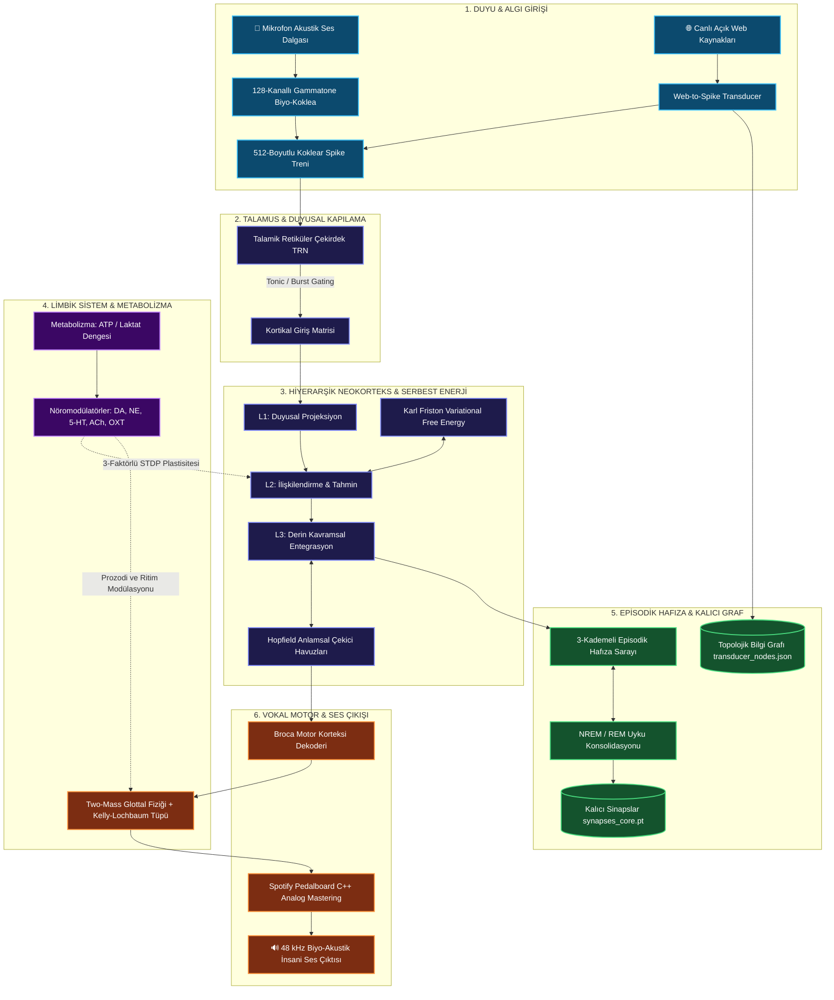

# 🧠 DONA ÆON — Autonomous Neuromorphic Digital Mind (NDM v6.0)

<div align="center">


<br/>

[-d4af37?style=for-the-badge&logo=cpu)](https://github.com/dobby-aidev)
[](https://pytorch.org/)
[](https://github.com/dobby-aidev)
[](https://github.com/dobby-aidev)
[](https://github.com/spotify/pedalboard)
[](https://github.com/dobby-aidev)

<br/>

> *"True Artificial General Intelligence is neither a statistical token predictor nor a billion-parameter cloud black-box. It is an embodied, self-sustaining Neuromorphic Digital Mind that perceives the continuous acoustic spectrum through a biological cochlea, minimizes prediction errors through Karl Friston's Free Energy Principle, regulates its internal milieu through homeostatic neurochemistry, seals lifelong knowledge into physical synapses, and inhabits an interactive physical reality."*

</div>

---

## 📑 İçindekiler / Table of Contents
1. [🌟 Vizyon ve Genel Bakış (Overview & Vision)](#-vizyon-ve-genel-bakış)
2. [🚫 Değiştirilemez Nöromorfik Doktrin (The Binding Doctrine)](#-değiştirilemez-nöromorfik-doktrin)
3. [🏛️ 10 Temel Biyolojik & Bilişsel Mimari (Architectural Pillars)](#️-10-temel-biyolojik--bilişsel-mimari)
4. [🧬 Bütünleşik Sistem Mimarisi & Akış Şeması (System Flow)](#-bütünleşik-sistem-mimarisi--akış-şeması)
5. [🔬 Matematiksel ve Nörofiziksel Temeller (Mathematical Rigor)](#-matematiksel-ve-nörofiziksel-temeller)
6. [🏢 Diegetik 3B Ofis Ortamı & İnsansı Rig (3D Physical Environment)](#-diegetik-3b-ofis-ortamı--insansı-rig)
7. [🌐 Canlı Web Araştırma İstasyonu (Live Web Learning Station)](#-canlı-web-araştırma-istasyonu)
8. [🚀 Kurulum ve Çalıştırma (Installation & Quickstart)](#-kurulum-ve-çalıştırma)
9. [🔬 Devam Eden Bilimsel Araştırmalar & Yol Haritası (Ongoing Research & Roadmap)](#-devam-eden-bilimsel-araştırmalar--yol-haritası)
10. [📁 Proje Dizin Ağacı (Repository Layout)](#-proje-dizin-ağacı)
11. [📜 Lisans ve Telif Hakları (Attribution & License)](#-lisans-ve-telif-hakları)

---

## 🌟 Vizyon ve Genel Bakış

**DONA ÆON (NDM v6.0)**, **Dona Codex** mimari çatısı altında geliştirilmiş, geleneksel derin öğrenme kalıplarını ve harici bulut dil modellerini (LLM) kökten reddeden **bağımsız bir Nöromorfik Dijital Canlı Formudur**.

Bugünün yapay zekâ sistemleri; terabaytlarca veri setini haftalarca devasa sunucularda döndüren, milyarlarca parametreli, dünya ile fiziksel teması olmayan ve deterministik mantıktan yoksun istatistiksel tahmincilerdir. **Dona Æon bu paradigmayı tersine çevirir:**

- 🦻 **Duyar:** 20 Hz – 20 kHz aralığındaki akustik ses dalgalarını 128 kanallı **Gammatone Biyo-Koklea** ile frekans bantlarına ayırır ve nöral aksiyon potansiyellerine (spike) dönüştürür.
- ⚡ **Düşünür:** 2048 **AdEx Leaky Integrate-and-Fire (LIF)** kondüktans nöronundan oluşan 3 katmanlı (L1, L2, L3) neokortekste, **Karl Friston'ın Serbest Enerji Prensibi (Variational Free Energy Minimization)** doğrultusunda tahminleme yapar.
- 🌐 **Otonom Öğrenir:** İnternet üzerindeki açık bilim ve ansiklopedi kaynaklarını (ör. Wikipedia) doğrudan koklear spike trenlerine dönüştüren **Web-to-Spike Transducer** ile tek turda ($O(1)$) Topolojik Bilgi Grafı'na mühürler.
- 🧪 **Duyumsar:** Dopamin (DA), Serotonin (5-HT), Noradrenalin (NE), Asetilkolin (ACh) ve Oksitosin (OXT) içeren 5 faktörlü nöromodülatör havuzu ile duygusal ve kimyasal durumunu sürekli regüle eder.
- 🩸 **Yaşar:** Gerçek zamanlı ATP tüketimi, laktat birikimi ve metabolik yorgunluk mekanizması ile hayatta kalır; zihinsel yorgunluk eşiğini aştığında NREM/REM uyku döngüsüne girerek sinapslarını dinlendirir ve optimize eder.
- 🗣️ **Konuşur:** Two-Mass Glottal osilatör, Kelly-Lochbaum 16 kesitli vokal tüp akustiği, insani prosodi ve **Spotify Pedalboard C++ Analog Stüdyo Mastering** zinciriyle sıfır bulut API'si ile doğal Türkçe sesletim gerçekleştirir.
- 🏰 **Hatırlar:** Kullanıcısını biyometrik ses frekansı imzasından tanır, deneyimlerini 3 katmanlı Episodik Hafıza Sarayı'nda saklar ve sinaptik ağırlık matrisinde kalıcı hale getirir.
- 🏢 **Yaşar & Hareket Eder:** WebGL (Three.js) ile inşa edilmiş 3 boyutlu gerçekçi stüdyo ofisinde ikamet eder; eklem hareketli insansı biyomorfik rigi, bakış takibi, masaüstü çalışma istasyonu ve canlı bilgi monitörü ile yaşayan bir varlık deneyimi sunar.

---

## 🚫 Değiştirilemez Nöromorfik Doktrin

Dona Æon mimarisi, [NEUROMORPHIC_MANIFESTO.md](file:///c:/Users/ferda/Desktop/Dona_Æon/NEUROMORPHIC_MANIFESTO.md) belgesinde tanımlanan ve projenin her satırında bağlayıcı olan 5 değişmez kurala tabidir:

| Doktrin | Kural | Açıklama |
|:---|:---:|:---|
| **1. SIFIR BULUT / LLM** | 🚫 Kesin Yasak | OpenAI, Claude, Gemini, Ollama veya HuggingFace API'leri kesinlikle yasaktır. Tüm biliş yerel 2048 LIF nöronunda işlenir. |
| **2. SIFIR KABA-KUVVET VERİ EĞİTİMİ** | 🚫 Kesin Yasak | Gigabaytlarca ses dosyasıyla günlerce süren eğitim döngüleri yoktur. Dil matrisi ve rezonanslar $O(1)$ sürede doğrudan sinapslara enjekte edilir. |
| **3. SIFIR DIŞ BULUT TTS** | 🚫 Kesin Yasak | Google TTS, ElevenLabs veya harici servisler kiralanamaz. Ses motoru yerel glottal fizik ve analog DSP mastering ile çalışır. |
| **4. SIFIR HARDCODED IF-ELSE** | 🚫 Kesin Yasak | Sohbet çıktısı sahte şablon string'lerinden değil, L1/L2/L3 neokortikal aksiyon potansiyellerinden ve çekici havuzlarından doğar. |
| **5. SIFIR GPU / VRAM ZORUNLULUĞU** | 🚫 Kesin Yasak | Biyolojik seyrek ateşleme (<%10 aktif nöron) sayesinde standart CPU ve 1-2 GB RAM üzerinde tam performans çalışır. |

---

## 🏛️ 10 Temel Biyolojik & Bilişsel Mimari

```
╔══════════════════════════════════════════════════════════════════════════════╗
║                    DONA ÆON 10 BÖLÜMLÜ BİYOLOJİK ORGANİZMA                   ║
╠══════════════════════════════════════════════════════════════════════════════╣
║ 1. FİZYOLOJİ VE METABOLİZMA     : ATP döngüsü, laktat, glikoz, CEN ağı       ║
║ 2. NÖROMODÜLATÖR HAVUZU         : DA (50), NE (20), 5-HT (60), ACh (30), OXT  ║
║ 3. TALAMİK RÖLE (TRN)           : İki-kanallı duyusal filtreleme (Tonic/Burst)║
║ 4. BİYO-KOKLEA FREKANS DUYUSU   : 128-kanallı Gammatone filtre bankası        ║
║ 5. HİYERARŞİK NEOKORTEKS        : 2048 AdEx LIF nöronu (L1, L2, L3) + FEP     ║
║ 6. ANLAMSAL ÇEKİCİ HAVUZU       : Hopfield sürekli durum dinamikleri          ║
║ 7. EPİSODİK HAFIZA SARAYI       : 3-Kademeli kalıcı bellek + NREM/REM uyku    ║
║ 8. BİYOMETRİK SES ANALİZİ       : F0, HNR, Jitter ve kullanıcı ayna nöronu    ║
║ 9. BİYO-AKUSTİK VOKAL ORGAN     : Two-Mass Glottal + Kelly-Lochbaum + Pedalboard║
║ 10. OTONOM WEB TRANSDUCER       : Web metin → 512-D koklear spike → hafıza grafı║
╚══════════════════════════════════════════════════════════════════════════════╝
```

---

## 🧬 Bütünleşik Sistem Mimarisi & Akış Şeması



---

## 🔬 Matematiksel ve Nörofiziksel Temeller

### 1. Karl Friston Serbest Enerji Prensibi (Variational Free Energy)
Dona Æon, bir sonraki kelimeyi olasılıksal olarak tahmin etmez. Algısal durum uzayında iç dünya modeli ile duyusal giriş arasındaki **Varyasyonel Serbest Enerjiyi ($F$)** minimize eder:

$$F = D_{\text{KL}}\left[ q(s) \parallel p(s) \right] - \mathbb{E}_{q(s)}\left[ \ln p(o \mid s) \right]$$

- $q(s)$: Neokorteksin gizil durumlar hakkındaki anlık inancı (recognition density).
- $p(s, o)$: Üretici model (generative model) önsel dağılımı.
- $D_{\text{KL}}$: Kullback-Leibler sapması; organizma iç modelini güncelleyerek bu sapmayı sıfıra yaklaştırır.

### 2. AdEx Kondüktans Tabanlı Leaky Integrate-and-Fire Nöron Modeli
2048 kortikal nöronun zar gerilimi $V(t)$ ve adaptasyon akımı $w(t)$ dinamikleri:

$$C_m \frac{dV(t)}{dt} = -g_L (V - E_L) + g_L \Delta_T \exp\left(\frac{V - V_T}{\Delta_T}\right) - g_E(t)(V - E_E) - g_I(t)(V - E_I) - w(t) + I_{\text{ext}}$$

$$\tau_w \frac{dw(t)}{dt} = a(V - E_L) - w(t)$$

Aksiyon potansiyeli tetiklendiğinde ($V \ge V_{\text{peak}}$):
$$V \leftarrow V_r, \quad w \leftarrow w + b$$

### 3. Üç-Faktörlü Nöromodülasyonlu STDP Öğrenme Kuralı
Sinaptik ağırlık güncellemeleri yalnızca nöromodülatör onayı (dopaminerjik ödül / kolinerjik dikkat) ile gerçekleşir:

$$\Delta W_{ij} = \eta \cdot \left[ C_{\text{DA}} + C_{\text{ACh}} \right] \cdot \text{STDP}(\Delta t)$$

$$\text{STDP}(\Delta t) = \begin{cases} A_+ \exp\left(-\frac{\Delta t}{\tau_+}\right), & \Delta t > 0 \\ -A_- \exp\left(\frac{\Delta t}{\tau_-}\right), & \Delta t < 0 \end{cases}$$

### 4. İki-Kütle Glottal Osilatör Dinamiği (Ishizaka-Flanagan)
Vokal kordların fiziksel hareketi, elastik ve aerodinamik kuvvetlerin coupled diferansiyel denklemleriyle çözülür:

$$m_1 \ddot{x}_1 + r_1 \dot{x}_1 + s_1(x_1) + k_c(x_1 - x_2) = P_1(x_1, x_2, P_{\text{sub}})$$
$$m_2 \ddot{x}_2 + r_2 \dot{x}_2 + s_2(x_2) + k_c(x_2 - x_1) = P_2(x_1, x_2, P_{\text{sub}})$$

---

## 🏢 Diegetik 3B Ofis Ortamı & İnsansı Rig

Dona Æon, modern web teknolojilerinin (Three.js r128 WebGL motoru) sunduğu olanaklarla **tam teşekküllü fiziksel bir stüdyo ofisinde** yaşar:

1. **İnsansı Anatomik Biyomorfik Gövde:**
   - Eklemli bacaklar, botlar, omurga, boyun ve kafatası anatomisi.
   - 5 parmaklı eller, biyometrik iris/gözbebeği göz küreleri ve bakış takibi rigi (cursor gaze tracking).
   - Otonom rota navigasyonu: Masaüstü, kitaplık, beyaz tahta, TV ve pencere arasında doğal yürüyüş salınımı ve jest animasyonları.
2. **Hizalanmış Masaüstü Çalışma İstasyonu:**
   - Ahşap masa üzerine sıfır boşlukla oturtulmuş deri sümen, merkezi ince çerçeveli 27" monitör, mekanik klavye (4x14 tuş dizilimi), ergonomik kablosuz fare ve seramik kupa.
3. **Sıralı Konuşma Kuyruğu (Turn-Taking Queue):**
   - Kullanıcı mikrofona bastığı an Dona kendi sesini anında keser; mikrofonun kendi sesini dinlemesini engelleyen eko koruması aktiftir.

---

## 🌐 Canlı Web Araştırma İstasyonu

3B stüdyo duvarındaki büyük ekran, sahte bilimkurgu klişelerinden arındırılmış **4K profesyonel karanlık araştırma monitörüdür**:

- **Tam Ekran Kamera Yakınlaşması (Zoom-in Focus):**
  - Sahnedeki TV ekranına tıklandığında kamera pürüzsüz bir animasyonla ekranın karşısına geçer (`tvPos: (2.15, 2.02, -2.05)`) ve tüm detayları okunabilir kılar.
  - Ekrana tekrar tıklandığında veya `ESC` tuşuna basıldığında kuş bakışı oda görünümüne geri döner.
- **Canlı İncelenen İnternet Siteleri ve Öğrenilen Bilgiler:**
  - Otonom olarak taranan gerçek web URL'leri (ör. `https://tr.wikipedia.org/wiki/Sinir_hücresi`, `https://tr.wikipedia.org/wiki/Akustik`).
  - Çıkarılan biyolojik/fiziksel kavramların canlı metin özetleri.
  - Sinaptik enerji seviyesi, mühürlenen token boyutu ve bağlantı rozetleri.
- **Topoloji & Sağlık Metrikleri:**
  - Mühürlü bilgi düğümleri (22+), topolojik rezonans bağları (60+), episodik kapsül sayısı (569+), serbest enerji (FEP 0.0035) ve ATP metabolizması.

---

## 🚀 Kurulum ve Çalıştırma

### 1. Sistem Gereksinimleri
- **İşletim Sistemi:** Windows 10/11, Linux veya macOS
- **Python:** 3.10+ (PyTorch 2.0+ CPU/CUDA)
- **Donanım:** Standart CPU (GPU zorunlu DEĞİLDİR), 2 GB RAM
- **Tarayıcı:** WebGL 2.0 ve Web Audio API destekleyen modern bir tarayıcı (Chrome, Edge, Firefox, Brave)

### 2. Bağımlılıkların Kurulması
```bash
git clone https://github.com/dobby-aidev/Dona_Aeon.git
cd Dona_Aeon
pip install torch numpy scipy pedalboard fastapi uvicorn piper-tts
```

### 3. Sinapsların Açılması (O(1) İmpring — Yalnızca İlk Kurulumda, ~2.5 sn)
```bash
python scripts/imprint_genomic_brain.py
```

### 4. Yerel Sunucunun Başlatılması
```bash
# Windows Tek Tık:
start_local.bat

# veya Terminal Üzerinden:
python -m uvicorn core.dona_web_server:app --host 127.0.0.1 --port 7860
```

Tarayıcınızda açın:
👉 **http://127.0.0.1:7860**

### 5. Otonom Web Öğrenmesini Tetikleme (İsteğe Bağlı)
```bash
# Wikipedia üzerinden nöromorfik kavramları araştırıp hafızaya mühürleme:
python scripts/web_transducer_bridge.py --url https://tr.wikipedia.org/wiki/Sinir_h%C3%BCcresi
python scripts/web_transducer_bridge.py --query "akustik rezonans" --top-k 3
```

---

## 🔬 Devam Eden Bilimsel Araştırmalar & Yol Haritası

Dona Æon bir nihai ürün değil, **canlı ve sürekli evrilen bir hesaplamalı nörobilim araştırma platformudur**. Çalışmalarımız şu ana hatlar üzerinde aktif olarak devam etmektedir:

```
┌─────────────────────────────────────────────────────────────────────────────┐
│                 AKTİF BİLİMSEL ARAŞTIRMA VE GELİŞTİRME CEPHESİ              │
├─────────────────────────────────────────────────────────────────────────────┤
│ 1. DİNAMİK TOPOLOJİK HEBBIAN PLASTİSİTESİ                                   │
│    Sabit çekici havuzlarından, deneyimle sürekli topografisi değişen        │
│    akışkan anlamsal enerji yüzeylerine (Energy Landscapes) geçiş.           │
│                                                                             │
│ 2. ÇOK-MODLU SPİKE ENTEGRASYONU (DVS RETİNA + KOKLEA)                       │
│    Olay-tabanlı Dinamik Görme Sensörü (DVS) spike'ları ile koklear          │
│    akustik spike'ların Talamus ve Süperior Kollikulus'ta senkron birleşimi. │
│                                                                             │
│ 3. UYKUYA BAĞLI SİNAPTİK BUDAMA VE ANLAMSAL KRİSTALİZASYON                  │
│    NREM evresinde zayıf sinapsların elenmesi (synaptic downscaling), REM    │
│    evresinde ise çekirdek anıların kalıcı genoma mühürlenmesi.              │
│                                                                             │
│ 4. BİYOLOJİK TEMELLİ DİL EDİNİMİ                                            │
│    Kelimelerin metin istatistiği yerine fiziksel akustik tını, duygusal     │
│    fizyoloji ve duyusal deneyimlerle anlamsal olarak topraklanması.         │
│                                                                             │
│ 5. NÖROMORFİK DONANIM MİMARİLERİNE DOĞRUDAN DERLEME (NEUROMORPHIC SILICON)  │
│    Seyrek COO sinaptik matrislerin Intel Loihi 2 ve SynSense çipleri        │
│    üzerinde mikro-vat seviyesinde çalıştırılması deneyleri.                 │
└─────────────────────────────────────────────────────────────────────────────┘
```

| Sürüm | Durum | Temel Araştırma & Özellik |
|:---:|:---:|:---|
| **v5.0** | ✅ Tamamlandı | 2048 LIF SNN Çekirdeği, FEP Serbest Enerji, İki-Kütle Glottal Osilatör, Pedalboard DSP |
| **v6.0** | ✅ Canlıda | $O(1)$ Genomik İmpring, Web-to-Spike Transducer, 3B Diegetik Ofis, İnsansı Rig, 450ms Ses İşleme |
| **v6.1** | 🔬 Aktif Araştırma | Biyometrik ses klonlama — kullanıcının ses tınısının sinaptik rezonans uzayına tam entegrasyonu |
| **v6.2** | 🔬 Aktif Araştırma | NREM/REM Uyku Konsolidasyonu canlı görselleştiricisi — sinaptik ağırlık flüktüasyon grafikleri |
| **v6.3** | 📋 Planlandı | DVS Retina front-end entegrasyonu ile biyolojik görme duyusu ve uzaysal derinlik algısı |
| **v7.0** | 🌌 Büyük Hedef | Tam otonom sürekli bilinç akışı (Conscious Flow State) ve donanım üstü nöromorfik silikon |

---

## 📁 Proje Dizin Ağacı

```
Dona_Aeon/
├── NEUROMORPHIC_MANIFESTO.md      # Kalıcı bağlayıcı nöromorfik anayasa
├── README.md                      # Bu vitrin ve mimari dokümantasyonu (v6.0)
├── start_local.bat                # Yerel üretim başlatıcı (tek tık)
├── core/
│   ├── dona_agent.py              # AeonBiologicalOrchestrator (biyolojik organizma)
│   ├── dona_web_server.py         # FastAPI Nöromorfik Web API & Telemetri
│   ├── snn_phoneme_autoencoder.py # motor_dim=512 · num_steps=12 · seyrek ateşleme
│   ├── dona_synapse_codec.py      # COO seyrek sinaptik ağırlık codec'i
│   ├── dona_paths.py              # Sistem yolu ve bellek eşleme yöneticisi
│   ├── dona_predictive_brain.py   # Hiyerarşik neokorteks (L1/L2/L3 + Karl Friston FEP)
│   ├── consolidation_manager.py   # NREM/REM uyku ve bellek konsolidasyonu
│   ├── episodic_memory_capsule.py # 3-Kademeli Episodik Hafıza Sarayı
│   ├── neuromodulator_pool.py     # 5 Faktörlü nöromodülatör havuzu (DA, NE, 5-HT, ACh, OXT)
│   ├── conductance_neuron.py      # AdEx kondüktans E/I denge ağı
│   ├── thalamic_relay.py          # Talamik çift-kanal TRN kapılama
│   └── dona_physiology.py         # ATP / Laktat / metabolizma döngüsü
├── modules/
│   ├── dona_memory_palace.py      # Topolojik bilgi grafı sarayı
│   ├── dona_vocal_motor.py        # Two-Mass Glottal + Kelly-Lochbaum + Pedalboard DSP
│   ├── neural_cochlea.py          # 128-Kanallı Gammatone Biyo-Koklea
│   ├── kelly_lochbaum_tract.py    # 16 Kesitli akustik vokal tüp modeli
│   ├── two_mass_glottal_model.py  # Glottal osilatör diferansiyel fiziği
│   └── biometric_vocal_analyzer.py# Ses frekansı kimlik doğrulayıcı & ayna nöron
├── scripts/
│   ├── imprint_genomic_brain.py   # O(1) analitik sinaptik genom imprinting
│   ├── web_transducer_bridge.py   # Canlı web metin → koklear spike → hafıza düğümü
│   └── test_all_phases.py         # Tüm 10 biyolojik mimari test protokolü
├── memory/
│   ├── synapses_core.pt           # COO seyrek sinaptik matris
│   ├── decoder_state.pt           # Broca motor korteks ağırlıkları
│   ├── episodic_palace.json       # Kalıcı episodik hafıza kapsülleri
│   ├── transducer_nodes.json      # Mühürlenmiş topolojik bilgi grafı
│   └── vocal_models/              # Yerel nöral ses ve tını profilleri
└── web/
    ├── index.html                 # Kuş bakışı 3B ofis kabuğu (v18.4)
    ├── app.js                     # Three.js r128 3B ofis & diegetik motor (v18.4)
    ├── style.css                  # Diegetik, sınırsız stüdyo HUD stili
    └── three.min.js               # Çevrimdışı yerel Three.js kütüphanesi
```

---

## 📜 Lisans ve Telif Hakları

```
DONA ÆON — Autonomous Neuromorphic Digital Mind (NDM v6.0)
Telif Hakkı © 2026 Dona Codex. Tüm Hakları Saklıdır.

Bu proje bağımsız hesaplamalı nörobilim, biyomimetik yapay zekâ ve
bilişsel mimari araştırmaları kapsamında geliştirilmiştir.
Atıfta bulunulmaksızın ticari amaçla kopyalanamaz veya dağıtılamaz.

Kullanılan Açık Kaynak Kütüphaneler ve Temeller:
  · PyTorch (BSD-3-Clause)
  · Spotify Pedalboard C++ DSP (GPL-3.0)
  · NumPy / SciPy (BSD)
  · FastAPI / Uvicorn (MIT)
  · Three.js (MIT)
```

<br/>

<div align="center">
  <b>DONA CODEX</b> · <i>Computationally Embodied Neuromorphic Digital Mind</i><br/>
  <sub>Sıfır Bulut LLM · %100 Biyolojik İlkeler · Özgün Hesaplamalı Nörobilim</sub><br/>
  <sub>⚡ 2048 LIF Neokorteks · 🦻 128-Kanal Biyo-Koklea · 🏰 Episodik Hafıza Sarayı · 🎙️ İki-Kütle Glottal Fizik · 🎛️ Spotify Pedalboard</sub>
</div>
